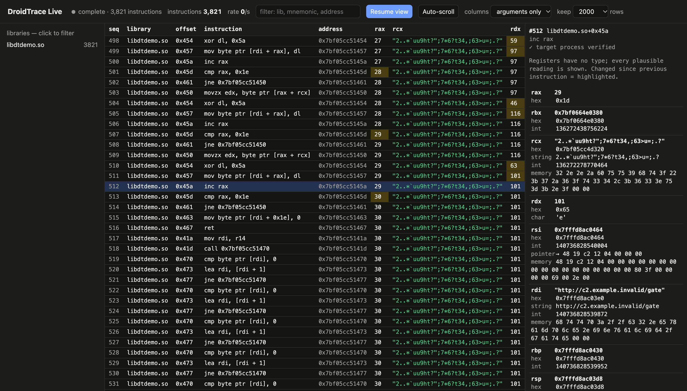
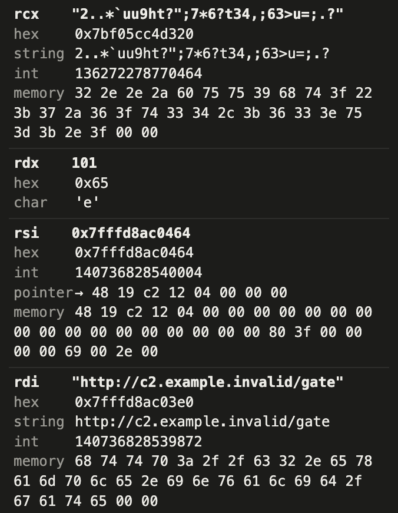
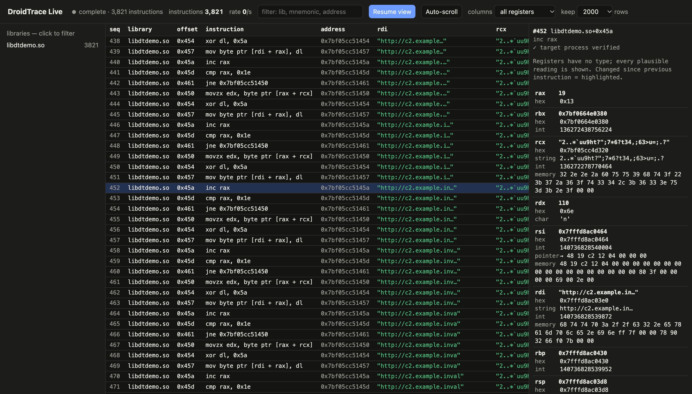
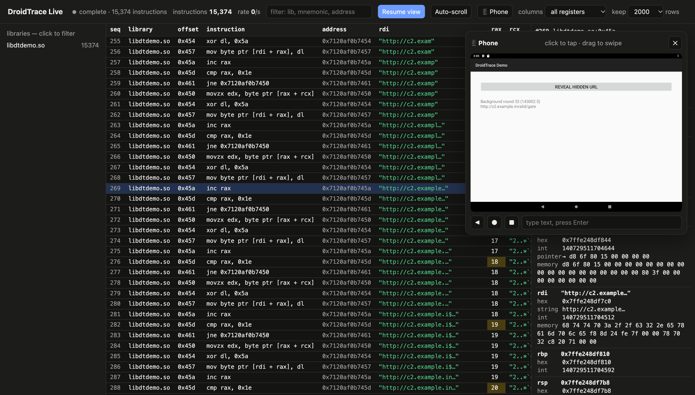
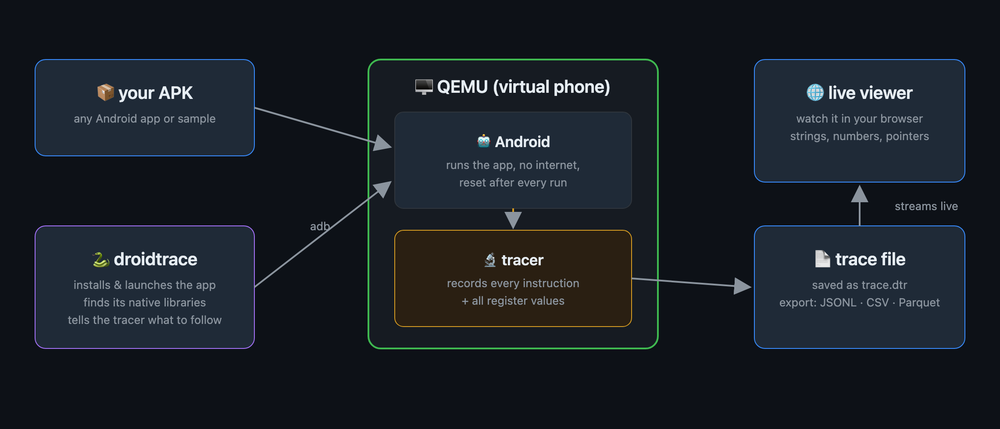
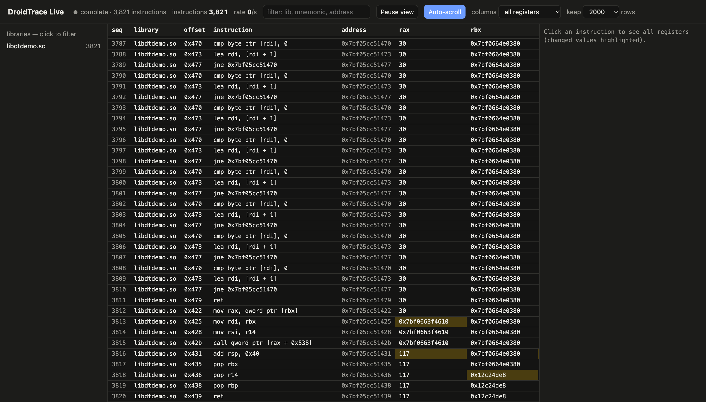
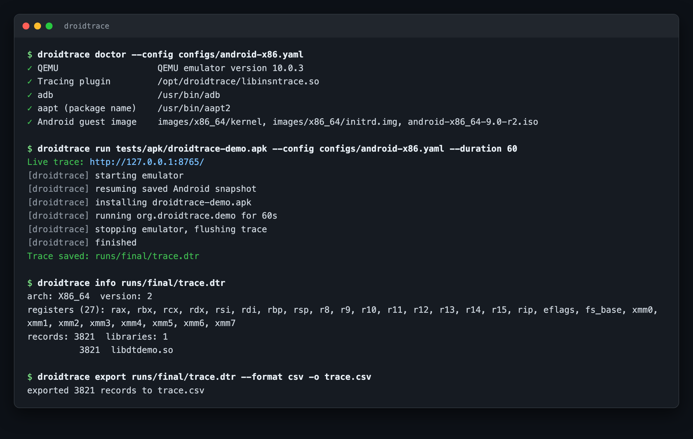

<div align="center">

# 🔬 DroidTrace

### See every instruction an Android app runs, live.

Drop in an APK and watch its native code execute line by line, with every register
turned into something you can read: text, numbers, pointers.

[](https://github.com/satpath-lab/droidtrace/actions/workflows/ci.yml)
[](LICENSE)


[](https://hits.sh/github.com/satpath-lab/droidtrace/)



<sub>A real capture: the demo app decrypts a hidden URL inside its native code, and the decoded
text shows up in register <code>rdi</code> the moment it is written.</sub>

[Quick start](#-quick-start) •
[Install](#-installation-options) •
[Phone screen](#-using-the-app-while-it-is-traced) •
[arm64](#-arm64-v8a-apps) •
[How it works](#-how-it-works) •
[Screenshots](#-screenshots) •
[Limitations](#%EF%B8%8F-limitations) •
[Using it at work](#-using-it-at-work) •
[FAQ](#-faq)

</div>

---

## 👋 Why I built this

When I analyse an Android app, the interesting part is usually hidden in its native code
(`.so` files): decrypting strings, checking for root, talking to a server. Reading that code
statically is slow, and debuggers stop the app at every step.

I wanted something simpler: **run the app and get a complete recording of what its native
code did**, instruction by instruction, with the values it worked on. So I built DroidTrace.

## 🕵️ Hidden strings, revealed

Malware rarely stores a server address in plain text. My demo app does what real samples do:
it keeps the URL scrambled and decrypts it only at runtime. DroidTrace catches it in the act:

<table>
<tr>
<td width="55%">

</td>
<td>

**`rcx`** points at what is stored inside the app:
`2..*`uu9ht?";7*6?t34,;63>u=;.?`
— meaningless bytes.

**`rdx`** holds the character being decrypted right now: `'e'`.

**`rdi`** points at the output, which now reads
**`http://c2.example.invalid/gate`**.

No reverse engineering needed: I just ran the app and read the result.

</td>
</tr>
</table>

And in the live viewer you can watch the URL being built, one letter per loop round, in the
`rdi` column (text values are shown in green):



<sub>Open it yourself with <code>http://127.0.0.1:8765/?find=c2.example&cols=rdi,rcx,rax,rdx</code>:
<code>find</code> jumps to the first instruction whose registers contain that text, and
<code>cols</code> picks which registers to show as columns.</sub>

## ✨ What you get

| | |
|---|---|
| 📍 **Where** | which library ran (`libc.so`, the app's own `libpayload.so`, …) and the exact offset |
| 🧠 **What** | the instruction itself, e.g. `mov x0, x1` or `call connect` |
| 🔢 **Values** | every CPU register at that moment |
| 🔤 **Meaning** | values turned into plain text: `"http://evil.example/gate"`, `-1`, `3.14`, `'e'`, `libc.so+0x1234` |
| 🎯 **Focus** | only the app you are analysing is recorded, not the rest of the phone |
| 📡 **Live** | everything streams into your browser while the app is running |
| 📱 **Interactive** | see the phone's screen in the browser and click, swipe and type on it |
| 💾 **Export** | save the trace and export it to JSONL, CSV or Parquet |

## 🚀 Quick start

**You need:** Docker, about **12 GB of free disk** while installing (around 5 GB once
installed), and **8 GB of RAM** (the virtual phone uses 2 GB). I built and tested it on an
8 GB Apple Silicon Mac; Linux works too.

```bash
# 1. Get the code and install the `droidtrace` command (downloads a ready-made image)
git clone https://github.com/satpath-lab/droidtrace.git
cd droidtrace
./install.sh

# 2. Download a virtual Android phone (Android-x86 9.0, ~920 MB, checksum verified)
scripts/get-android-x86.sh

# 3. Boot it once and save it (one time only, 10-30 minutes)
droidtrace prepare --config configs/android-x86.yaml

# 4. Run an app and watch it live (starts in seconds from now on)
droidtrace run my-app.apk --config configs/android-x86.yaml
```

Your browser opens at **http://127.0.0.1:8765** and the trace starts flowing.

> 💡 **Try it safely first.** I included a harmless demo app that hides a URL the way malware
> often does. Run it and watch the URL appear:
> ```bash
> droidtrace run tests/apk/droidtrace-demo.apk --config configs/android-x86.yaml
> ```
> The app decrypts the URL every 2 seconds. Open **http://127.0.0.1:8765/?find=gate** to jump
> straight to that moment, or click **📱 Phone** and tap the app's **Reveal hidden URL** button
> to trigger it yourself.

Not sure everything is set up? Run `droidtrace doctor`: it checks each piece and tells you
what is missing.

## 🧰 Installation options

Pick whichever suits you. All of them give you the same `droidtrace` command.

<details open>
<summary><b>1. Installer (easiest)</b></summary>

```bash
git clone https://github.com/satpath-lab/droidtrace.git
cd droidtrace
./install.sh
```

It downloads the ready-made Docker image and installs a `droidtrace` command in
`~/.local/bin`. Nothing else is installed on your machine. To build the image yourself
instead of downloading it: `DROIDTRACE_BUILD=1 ./install.sh`.
</details>

<details>
<summary><b>2. Docker image from GitHub Packages</b></summary>

Every version is published at
[ghcr.io/satpath-lab/droidtrace](https://github.com/satpath-lab/droidtrace/pkgs/container/droidtrace)
for x86_64 and arm64 (Apple Silicon included). No login needed.

```bash
docker pull ghcr.io/satpath-lab/droidtrace:latest      # or a fixed version, e.g. :v0.1.0

# run any droidtrace command; your current folder is available inside as /work
docker run --rm -it -v "$PWD:/work" -p 127.0.0.1:8765:8765 \
  ghcr.io/satpath-lab/droidtrace:latest \
  run app.apk --config configs/android-x86.yaml --host 0.0.0.0 --no-browser
```

Then open http://127.0.0.1:8765. (The installer above simply wraps this `docker run` for you.)
</details>

<details>
<summary><b>3. Build the Docker image yourself</b></summary>

```bash
git clone https://github.com/satpath-lab/droidtrace.git && cd droidtrace
docker build -t droidtrace:local -f docker/Dockerfile .   # compiles QEMU, about 15 minutes
docker builder prune -af                                 # optional: frees several GB of build cache
```

Use `droidtrace:local` in place of the image name above, or run `./install.sh` afterwards.
Building yourself is useful when your organisation requires building from source.
</details>

<details>
<summary><b>4. Python package from Releases (no Docker)</b></summary>

For Linux machines where you manage QEMU yourself. Download the `.whl` file from the
[Releases page](https://github.com/satpath-lab/droidtrace/releases) and install it:

```bash
pip install droidtrace-0.1.1-py3-none-any.whl
# or straight from GitHub:
pip install "droidtrace[disasm,parquet] @ git+https://github.com/satpath-lab/droidtrace@v0.1.1"
```

You also need, on the same machine:

- **QEMU 10.0.3 with the tracer**: apply `qemu-patch/apply.sh` to the QEMU source and build
  it (fast engine), or build the plugin with `make plugin QEMU_SRC=...` (plugin engine)
- **adb** and **aapt2** from the Android SDK platform-tools / build-tools

Then run `droidtrace doctor` to check everything is found.
</details>

## 📱 Using the app while it is traced

Some behaviour only happens after you do something: log in, press a button, open a screen.
Click **📱 Phone** in the viewer to see the virtual phone's screen live:

- **click** to tap, **drag** to swipe
- **◀ ● ■** for Back, Home and Recent apps
- type in the text box and press Enter to send text to the focused field

Right after a run starts, Android may show **"System UI isn't responding"** for a moment
(the phone's clock jumps when the saved snapshot is restored). Tap **Wait** in the panel; the
app keeps running underneath.

Everything you trigger shows up in the trace as it runs. Add `?phone=1` to the viewer address
to open the phone panel straight away.



<sub>The demo app on the virtual phone (right), while its native library's instructions stream in
on the left.</sub>

## 🌐 Apps that need the internet

By default the phone has **no internet**. That is the safe choice for malware: it cannot
download more code, steal data or attack anything.

Some apps (and some malware) do nothing interesting until they reach their server. When you
need that, turn the internet on for one run:

```bash
droidtrace run app.apk --config configs/android-x86.yaml --internet
```

The app can then reach real servers through your machine's connection. **Only do this on an
isolated analysis machine** (a spare computer or a VM on a separate network), never on your
work laptop or office network.

Expect the phone to be slower with internet on: Google services on the phone start syncing
and downloading, which keeps the emulated CPU busy. Give the run more time (`--duration`).

## 📦 arm64-v8a apps

Most apps ship native code only for `arm64-v8a`. The quick-start phone (Android-x86) runs
x86_64 code, so it cannot run those libraries; DroidTrace detects this and tells you before it
installs anything. The fast tracer itself is built for arm64. To trace arm64-v8a apps, run an
arm64 Android (Google's Cuttlefish) on the patched QEMU and connect with `--attach`. The full
steps are in [docs/arm64.md](docs/arm64.md).

## 🧭 How it works



1. **A virtual phone.** DroidTrace starts Android inside QEMU (an emulator). The phone has no
   internet access and is reset after every run.
2. **Your app.** It installs your APK, opens it, and watches which native libraries it loads.
3. **The tracer.** Built into QEMU, it records each instruction those libraries run, together
   with every register value, and checks that it really came from your app.
4. **You.** The live viewer shows it as it happens, and the trace is saved for later.

The slow part (booting Android) happens once, in `droidtrace prepare`. After that every run
starts from a saved snapshot of the booted phone, in seconds.

## 📸 Screenshots

### Following the decryption step by step


How to read it, from left to right:

- **Left:** the library being traced, `libdtdemo.so`, and how many instructions it ran.
- **Middle:** each instruction in order. Offsets `0x450`-`0x461` are the decryption loop:
  `movzx` loads one scrambled byte, `xor dl, 0x5a` decrypts it, `mov` stores it.
- **Columns:** `rax` counts up to 30 (the URL length) and `rdx` shows each decrypted
  character as a number. Yellow cells changed since the row above.
- **Right:** every register of the selected row, decoded. A few rows later (`0x41a`-`0x41d`) the
  finished URL is passed to the function that would contact the server.
- **✓ target process verified:** the instruction really came from the app, not from another
  process on the phone.

### The end of the run



On row 3815, `call qword ptr [rax + 0x538]` is the native code calling Android's
`NewStringUTF`, handing the decrypted text back to the Java side of the app.

### From the terminal



## 🎛️ Everyday commands

| I want to… | Command |
|---|---|
| check my setup | `droidtrace doctor` |
| run an app and watch it | `droidtrace run app.apk` |
| run a split app (from Google Play / APKMirror / bundletool) | `droidtrace run app.apks` (also `.xapk`, `.apkm`, or a folder of `.apk` files) |
| follow specific libraries | `droidtrace run app.apk --libs 'libnative*.so,libc.so'` |
| watch for longer | `droidtrace run app.apk --duration 300` |
| keep traces small | `droidtrace run app.apk --max-size 500` (MB) |
| reopen a saved trace | `droidtrace view runs/<run>/trace.dtr` |
| jump to a string | open the viewer with `?find=<text>`, e.g. `http://127.0.0.1:8765/?find=gate` |
| let the app use the internet | `droidtrace run app.apk --internet` |
| skip the phone screen | `droidtrace run app.apk --no-screen` |
| use a phone that's already running (e.g. arm64) | `droidtrace run app.apk --attach 127.0.0.1:6520` |
| get the data out | `droidtrace export runs/<run>/trace.dtr --format csv -o trace.csv` |
| summarise a trace | `droidtrace info runs/<run>/trace.dtr` |

Every run gets its own folder under `runs/` with the trace, the list of libraries, the
emulator log and a `manifest.json` (APK hash, settings, timestamps), so results are easy to
archive and reproduce.

## ⚡ Two tracing engines

| Engine | Speed | Works with |
|---|---|---|
| **Built-in** (default on arm64) | fastest: about **7×** faster than the plugin | patched QEMU 10.0.3, arm64 Android |
| **Plugin** | slower | any QEMU 10+, arm64 and x86_64 Android |

Code outside the libraries you follow runs at normal emulator speed with either engine.

<details>
<summary>📊 Benchmark</summary>

700,000 traced instructions, each with 42 registers and string capture, on QEMU 10.0.3:

| | Time |
|---|---|
| No tracing | 0.04 s |
| Plugin engine | 1.99 s |
| **Built-in engine** | **0.29 s** |

Untraced code: about 2-5 % overhead with the plugin, none with the built-in engine.
</details>

## ✅ What I tested

| Test | Result |
|---|---|
| Android-x86 9.0 boots, `prepare` saves a snapshot, `run` resumes in seconds, all unattended | ✅ |
| Demo APK installs, launches, and its native library is found automatically | ✅ |
| Every instruction of the app's library recorded in order (3,821 in the latest run) | ✅ |
| Only the app's own process recorded (every record verified) | ✅ |
| Hidden URL readable the moment it is decrypted | ✅ |
| Live viewer, `view`, `info`, export to JSONL / CSV / Parquet | ✅ |
| Built-in and plugin engines produce identical traces (arm64 test program on real QEMU) | ✅ |
| Size cap stops recording before the disk fills | ✅ |
| Phone screen shown in the browser; clicking it taps the phone (dismissed a dialog) | ✅ |
| `--internet`: the phone reaches real servers and resolves names (DNS) | ✅ |
| APK built only for another CPU type is detected before installing | ✅ (unit test) |
| Split apps (`.apks`, `.xapk`, `.apkm`, folder): the right CPU split is chosen | ✅ (unit tests) |
| Automated checks: unit tests, linting, type checking, end-to-end tests in CI | ✅ |
| Full arm64 Android image (AOSP / Cuttlefish) | ⏳ next, see limitations |

## ⚠️ Limitations

I want you to know exactly what DroidTrace can and cannot do:

- **It is slower than a real phone.** To see each instruction, the phone is emulated in
  software (no hardware acceleration). The first boot takes 10-30 minutes, and traced code
  runs much slower than normal. Follow only the libraries you care about.
- **It records native code only.** Java/Kotlin code runs inside Android's runtime (ART) and is
  not shown as Java source. DroidTrace is built for `.so` libraries.
- **Traces grow fast.** Each instruction takes a few hundred bytes, so millions of instructions
  mean gigabytes. A size cap (2 GB by default) stops recording when it is reached.
- **arm64-v8a apps need an arm64 Android.** The quick-start phone is x86_64 and cannot run
  arm64-only native code. The arm64 path (Cuttlefish + `--attach`, see
  [docs/arm64.md](docs/arm64.md)) is built but not tested end to end yet; the fast tracer
  itself is tested on arm64 programs.
- **The Android Studio emulator cannot be used.** It is based on a very old QEMU without
  tracing support.
- **Internet is off by default.** Use `--internet` when an app needs it, and only on an isolated
  machine. Some apps also check whether Google Play services or a real SIM card are present,
  which this virtual phone does not have.
- **Some malware hides from emulators.** Apps that detect emulation may behave differently or do
  nothing. Packed or anti-tamper protected apps were not tested.
- **Text is best-effort.** It is shown when a register points at readable memory; only the
  first 32 bytes are captured.
- **Apps protected by Google Play (e.g. PairIP, Play Integrity) usually won't run normally.**
  They check that they were installed from the Play Store on a certified, unrooted, real
  device, and this phone is none of those. They typically show an error or close. Their
  native protection code still runs first, so you can trace what it checks, but DroidTrace
  does not try to bypass these protections.
- **The fast engine is pinned to QEMU 10.0.3.** Other QEMU versions need the plugin engine or a
  small update to the patch.

## 🏢 Using it at work

I designed DroidTrace so a security team can adopt it without surprises:

- **Isolated by default.** No internet for the phone unless you ask for it (`--internet`), a
  clean snapshot on every run, the viewer only listens on `127.0.0.1`, and the container runs
  without extra privileges.
- **Reproducible.** Pinned QEMU version, versioned trace format, one Docker image, and a
  `manifest.json` per run with the APK's SHA-256 and the exact settings.
- **Bounded.** Hard limits on trace size and phone memory, so a run cannot exhaust a host.
- **Automatable.** Everything is a CLI command with machine-readable output (JSONL / CSV /
  Parquet), easy to drive from a pipeline or a job queue.
- **Open and auditable.** Apache-2.0 code, documented file format, CI with tests, linting,
  type checking, CodeQL and Dependabot.
- **Ready-made builds.** Every version is published as a Docker image for x86_64 and arm64
  (`ghcr.io/satpath-lab/droidtrace`) and as a Python package on the Releases page.

Read [docs/deployment.md](docs/deployment.md) for running it on shared or air-gapped
infrastructure, and [SECURITY.md](SECURITY.md) for how to report problems.

## ❓ FAQ

<details>
<summary><b>Is it safe to run real malware with this?</b></summary>

It is built for that, but no sandbox is perfect. Use a spare machine or VM, keep the default
isolation on, and read [docs/safety.md](docs/safety.md).
</details>

<details>
<summary><b>Why not just use Frida?</b></summary>

Frida is great for hooking specific functions. DroidTrace records <i>everything</i> a library
does, without injecting anything into the app, which is harder for malware to notice and gives
you a complete history to search afterwards.
</details>

<details>
<summary><b>Why no hardware acceleration (KVM / Apple Hypervisor)?</b></summary>

With hardware acceleration the real CPU runs the app's code directly, and QEMU never sees the
individual instructions, so there is nothing to record. Tracing needs QEMU's software CPU,
which translates every instruction, and that is what makes the phone slower. DroidTrace keeps
the cost down by only recording the libraries you follow and by booting Android only once
(`prepare`).
</details>

<details>
<summary><b>Will apps that need Google Play (PairIP / Play Integrity) work?</b></summary>

Usually not normally: see the limitation above. You can still trace the protection code
itself, which is often exactly what you want to study.
</details>

<details>
<summary><b>Can I run split APKs (.apks / .xapk / .apkm)?</b></summary>

Yes. Pass the file (or a folder of `.apk` files) to `droidtrace run`. DroidTrace installs the
base APK, the language and screen splits, and the CPU split that matches the phone.
</details>

<details>
<summary><b>What are the Releases and Packages on GitHub?</b></summary>

Each version I publish (for example v0.1.0) appears under **Releases** with its notes and the
Python package files. **Packages** holds the ready-made Docker image, which `./install.sh`
downloads so you don't have to compile QEMU yourself.
</details>

<details>
<summary><b>Can I trace Java code?</b></summary>

Not as Java. DroidTrace sees machine instructions, so it is aimed at native libraries.
</details>

<details>
<summary><b>How big do traces get?</b></summary>

A few hundred bytes per instruction. The demo run is 2 MB. Use `--libs` to follow less code
and `--max-size` to cap the file.
</details>

## 📂 Project layout

```
qemu-patch/   fast built-in tracer (a patch for QEMU)
plugin/       portable tracer (a QEMU plugin)
src/          the droidtrace command and the live viewer
configs/      ready-made settings (Android-x86, arm64)
scripts/      helpers, e.g. downloading Android-x86
tests/        unit tests, end-to-end tests and the demo APK
docs/         guides: architecture, file format, deployment, safety, operations
docker/       the image that bundles everything
```

## 🤝 Contributing

Issues and pull requests are welcome. Start with [CONTRIBUTING.md](CONTRIBUTING.md); for help,
see [SUPPORT.md](SUPPORT.md).

## 📄 License

Apache-2.0, see [LICENSE](LICENSE). The QEMU patch in `qemu-patch/` is GPL-2.0-or-later, like
QEMU itself; details in [docs/licensing.md](docs/licensing.md).

If DroidTrace helps your research, you can cite it using [CITATION.cff](CITATION.cff).
